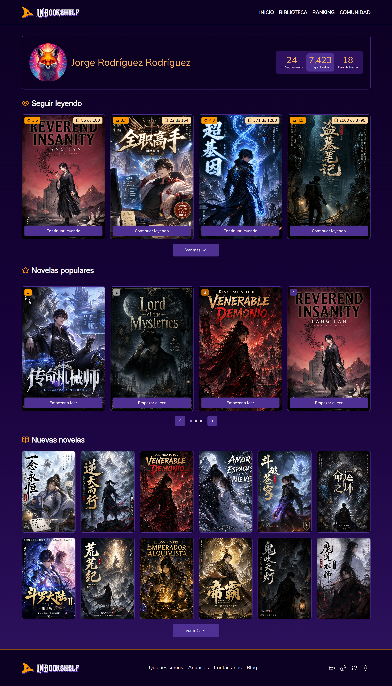
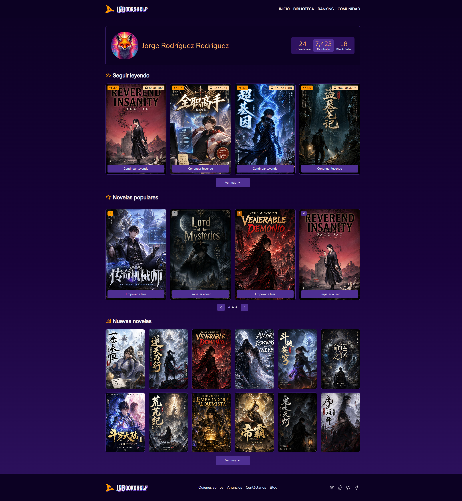

# P3.1 Maquetación con Vite y SASS

**S2DAW Diseño Web**
**Autor:** _Jorge Rodríguez Rodríguez_

---

## 1. Descripción

Se trata de una página web para **leer novelas chinas**. La página de inicio muestra distintas secciones para descubrir y retomar lecturas: novelas populares, nuevas novelas y una sección para seguir leyendo donde lo dejaste.

La aplicación está creada con **React**, **JavaScript** y **Sass (SCSS)**, y se ha montado con **Vite**.

## 2. Tecnologías utilizadas

- **React** para construir la interfaz a partir de componentes.
- **JavaScript (JSX)** para la lógica de los componentes.
- **Sass (SCSS)** para los estilos, organizados en parciales.
- **Vite** como herramienta de desarrollo y empaquetado.
- **pnpm** como gestor de paquetes.
- **ESLint** y **Prettier** para mantener el código ordenado.

## 3. Estructura del proyecto

```text
proyecto-final-diw/
├── docs/
├── public/
├── src/
│   ├── assets/
│   ├── components/
│   │   ├── atoms/          # Button, Logo, Pill, VerMasButton
│   │   ├── molecules/      # ImageCard, ImageCardSmall, ProfileCard
│   │   ├── organisms/      # NovelasPopularesSection, NuevasNovelasSection, SeguirLeyendoSection
│   │   ├── layout/         # Header, Footer
│   │   └── ui/             # Iconos SVG (BookIcon, StarIcon, DiscordIcon...)
│   ├── pages/
│   │   └── HomePage.jsx
│   ├── templates/
│   │   └── PageTemplate.jsx
│   ├── styles/
│   │   ├── _fonts.scss
│   │   ├── _global.scss
│   │   ├── _layout.scss
│   │   ├── _mixins.scss
│   │   ├── _reset.scss
│   │   ├── _variables.scss
│   │   └── main.scss
│   ├── App.jsx
│   └── main.jsx
├── index.html
├── package.json
├── vite.config.js
└── README.md
```

Cada componente tiene su archivo `.jsx` y, cuando lo necesita, su archivo `.scss` con el mismo nombre.

## 4. Organización de los componentes (Atomic Design)

Los componentes siguen la metodología **Atomic Design**:

| Nivel         | Descripción                                          | Componentes                                                               |
| ------------- | ---------------------------------------------------- | ------------------------------------------------------------------------- |
| **Atoms**     | Elementos básicos que no se pueden dividir más.      | `Button`, `Logo`, `Pill`, `VerMasButton`                                  |
| **Molecules** | Combinaciones sencillas de átomos.                   | `ImageCard`, `ImageCardSmall`, `ProfileCard`                              |
| **Organisms** | Secciones completas formadas por moléculas y átomos. | `NovelasPopularesSection`, `NuevasNovelasSection`, `SeguirLeyendoSection` |
| **Layout**    | Estructura común a todas las páginas.                | `Header`, `Footer`                                                        |
| **Templates** | Plantilla que une el layout con el contenido.        | `PageTemplate`                                                            |
| **Pages**     | Páginas finales de la aplicación.                    | `HomePage`                                                                |

Los iconos (libro, estrella, flechas, redes sociales...) están en `components/ui` como componentes SVG reutilizables.

## 5. Organización de los estilos (Sass)

Los estilos están en `src/styles` divididos en parciales que se importan desde `main.scss`:

- `_reset.scss`: normaliza los estilos por defecto del navegador.
- `_fonts.scss`: tipografías utilizadas.
- `_variables.scss`: colores, tamaños y demás variables.
- `_mixins.scss`: mixins reutilizables.
- `_global.scss`: estilos globales.
- `_layout.scss`: estilos de la estructura general de la página.

Además, cada componente tiene su propio archivo SCSS con los estilos que le corresponden.

## 6. Instalación y ejecución

1. Clonar el repositorio:

   ```bash
   git clone https://github.com/JorgeDip/proyecto-final-diw.git
   cd proyecto-final-diw
   ```

2. Instalar las dependencias:

   ```bash
   pnpm install
   ```

3. Arrancar el servidor de desarrollo:

   ```bash
   pnpm dev
   ```

4. Generar la versión de producción:

   ```bash
   pnpm build
   ```

## 7. Capturas de pantalla





## 8. Conclusiones

Sass es una herramienta muy potente: las variables, los mixins y la
división en parciales hacen que los estilos sean más reutilizables y
fáciles de mantener. Sin embargo, durante el proyecto he comprobado que
tiene un inconveniente: cuando un archivo acumula muchas clases anidadas,
resulta difícil seguir qué estilos se aplican a cada elemento y es fácil
perderse.

Por eso, en futuros proyectos intentaré limitar el nivel de anidación y
mantener los archivos SCSS más pequeños, con un archivo por componente.
